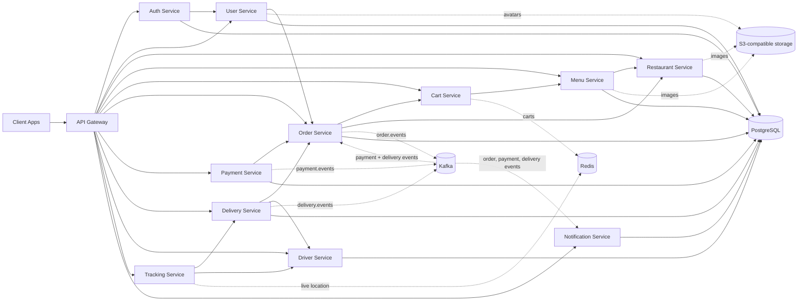

##  Overview

**Delivery Plus** is a backend food-delivery platform built as independently deployable **microservices** that communicate over REST and **Kafka** events. Domain responsibilities are separated across auth, users, restaurants, menus, carts, orders, payments, drivers, deliveries, tracking, and notifications. PostgreSQL-backed services own relational data; cart and tracking use Redis; images live in S3-compatible object storage, uploaded directly by clients through presigned POST policies; the gateway owns no domain data.

For a one-page status of what is implemented, partial, or missing today, see [`.project-context/16-current-state.md`](./.project-context/16-current-state.md).

This is the **backend** of the Delivery Plus platform — no frontend/UI is included here by design. The customer, driver and restaurant apps live in companion repositories (below) and, like any third-party client, talk to the platform only through the **API Gateway**.

##  The Delivery Plus platform

Delivery Plus connects three roles around one order: a **customer** orders from a **restaurant**, the restaurant prepares it, the platform dispatches a **driver**, and everyone follows the same order and delivery state in real time.

```text
Delivery Plus  (github.com/Delivery-Plus0)
│
├── delivery-plus                  Backend platform (this repository)
│   └── 12 NestJS services behind one API Gateway · Kafka events · PostgreSQL · Redis · S3
│
├── delivery-plus-customer-app     Customer app (Expo / React Native: Android, iOS, web)
│   └── browse · cart · checkout · order status · live driver tracking · alerts
│
├── delivery-plus-driver-app       Driver app (Expo / React Native)
│   └── online/offline · automatic job assignment · pickup → delivered · location sharing
│
└── delivery-plus-restaurant-app   Restaurant app (Expo / React Native, web-first)
    └── incoming orders · kitchen workflow (preparing → ready for pickup) · availability
```

| Repository | Responsibility | Visibility |
|---|---|---|
| [`delivery-plus`](https://github.com/Delivery-Plus0/delivery-plus) | Business rules, data, events, auth and the public API. The single source of truth for order, payment, delivery and tracking state; also hosts the project-wide issue tracker and roadmap milestones. | Public |
| [`delivery-plus-customer-app`](https://github.com/Delivery-Plus0/delivery-plus-customer-app) | The customer experience. | Public |
| [`delivery-plus-driver-app`](https://github.com/Delivery-Plus0/delivery-plus-driver-app) | The driver experience. | Public |
| [`delivery-plus-restaurant-app`](https://github.com/Delivery-Plus0/delivery-plus-restaurant-app) | The restaurant experience. | Public |
| `delivery-plus-admin-app` | The staff console (operations, support, onboarding, finance). Built from Production 3 on. | Private |

The customer, driver and restaurant apps share one UI kit, kept byte-identical against [`clients/kit-manifest.json`](./clients/kit-manifest.json) in this repository. It covers dialogs, sheets, toasts, sessions, the email-code screen, and Arabic/English with RTL. The admin app joins it in Production 3.

How they interact: every app calls the API Gateway over HTTPS with a JWT whose role (`CUSTOMER`, `DRIVER`, `RESTAURANT_OWNER`) decides what it may do; the apps never talk to each other or to individual services. State changes flow through the backend (for example: restaurant marks an order ready → `order.ready_for_pickup` → automatic dispatch assigns an online driver → the driver app sees the job → the customer app shows the driver and the live map). Each app's E2E suite runs against this repository's isolated E2E stack, and the customer app's business flow drives all three apps in one browser.

##  Project status

Honest status, tracked in this repository's [milestones](https://github.com/Delivery-Plus0/delivery-plus/milestones) and the [production roadmap](./docs/roadmap/production.md). Details per area: [`.project-context/16-current-state.md`](./.project-context/16-current-state.md).

**Implemented**
- **Accounts:**
  - customer, driver, restaurant owner and staff (admin) roles;
  - 15-minute access tokens with rotating refresh tokens, where reusing an old refresh token ends the session;
  - sign-out everywhere, account suspension and staff permissions;
  - services call each other as a separate `SYSTEM` identity;
  - email verification by a 6-digit code (Amazon SES);
  - phone verification by SMS code, and password change and reset by SMS code;
  - per-client rate limits behind proxies (`TRUSTED_PROXY_HOPS`).
- **Catalogue and ordering:**
  - restaurants, menus with categories, images, availability and archiving;
  - an atomic Redis cart;
  - checkout with a server-side delivery fee (EGP);
  - idempotent order creation, cancellation and refund rules, reject-with-reason for restaurants.
- **Events:** order and delivery events go through a transactional outbox; Kafka consumers deduplicate, retry, and park failures in dead-letter topics.
- **Payments:** **simulated** only, with no real card provider yet. The simulator refuses to run in production.
- **Delivery:**
  - automatic dispatch to verified drivers only;
  - the delivery lifecycle (assigned → picked up → in transit → delivered);
  - a driver earnings ledger and wallet;
  - customers rate drivers.
- **Live tracking:** the driver's location is bound to the active delivery, with server-sent events and a polling fallback, and a customer-safe driver card.
- **Notifications:** in-app, localized by message key (Arabic and English). No push notifications yet.
- **Media:** S3-compatible uploads through presigned POST.

**In progress:** the [production roadmap](./docs/roadmap/production.md), 10 milestones from a hotfix to a paid pilot.
- **Production 0** (hotfix) is done.
- **Production 1** (accounts and sessions) is done in this repository. The apps' password change and reset screens are the last open part.
- **Production 2** (onboarding and service area) has started with fair, longest-idle dispatch (#210).

**Planned / not built yet** (see the roadmap):
- Driver and restaurant onboarding, delivery areas (M2).
- The admin console (M3–M4).
- Staging, hardening and the NestJS upgrade (M5).
- Real payments, settlements and payouts (M6).
- Real SMS, push notifications, background location (M7).
- ETA estimation (the contract exists, no estimator).

##  Architecture



Every service is self-contained and shares a common foundation through the internal `shared` library. The shared package provides enums, transition helpers, Kafka/Redis helpers, S3 media storage, internal service authentication, JWT and role guards, logging, and common NestJS utilities. Redis is also used for caching, rate limits, and internal-auth nonces, which the diagram omits for readability. Kafka consumers deduplicate events per consumer group in Redis, retry a failing handler three times, then park the message in a `<topic>.dlq` dead-letter topic that `npm run kafka:dlq` can list and replay; events are keyed by `orderId`. Order and delivery events go through a transactional outbox (written in the same database transaction as the state change, then relayed to Kafka); payment-service still publishes directly, at most once per payment status.

##  Tech Stack

| Layer | Technology |
|---|---|
| Runtime | Node.js 22 LTS |
| Language | TypeScript 5 |
| Framework | NestJS 10 |
| Database | PostgreSQL 16 |
| Cache / Real-time state | Redis 7 |
| Messaging / Events | Apache Kafka |
| Media storage | S3-compatible object storage (SeaweedFS in local dev/test) |
| Containerization | Docker & Docker Compose |
| Testing | Jest (unit + e2e) |
| Shared internals | Custom `shared` package (events, guards, filters, utils) |

##  Services

| Service | Responsibility |
|---|---|
| `api-gateway` | Single entry point and routing; blocks internal routes and refuses service tokens from outside; forwards the client IP for rate limits |
| `auth-service` | Credentials, access and refresh tokens, sessions, account status, staff permissions, email verification, password change and reset |
| `user-service` | User profiles, avatars, Egyptian phone numbers and SMS codes |
| `restaurant-service` | Restaurant records, status and images |
| `menu-service` | Menu categories and items, availability, images, archiving |
| `cart-service` | Shopping cart (Redis-backed, compare-and-set writes) |
| `order-service` | Order lifecycle, delivery fee, cancellation rules, outbox events |
| `payment-service` | Payments and refunds (simulated provider) |
| `driver-service` | Driver profiles, verification gate, availability and the dispatch queue |
| `delivery-service` | Automatic dispatch, delivery lifecycle, driver earnings ledger, ratings |
| `tracking-service` | Live location tracking (Redis-backed, server-sent events) |
| `notification-service` | In-app notifications for every order stage |

Every service, including the API Gateway, exposes a `/health` route used by Compose healthchecks. These are liveness checks; they do not prove that Kafka, Redis, or downstream services are reachable. Services generally follow `controllers → services → repositories/entities`, with variations by service.
